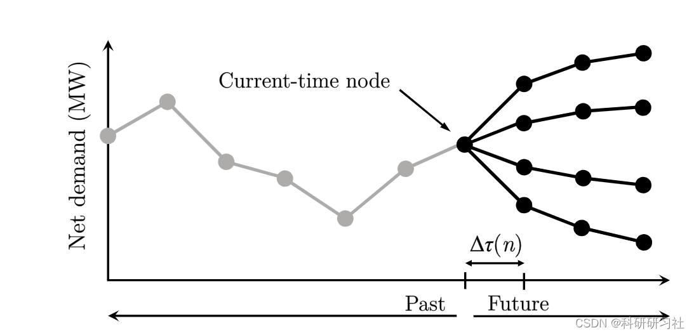
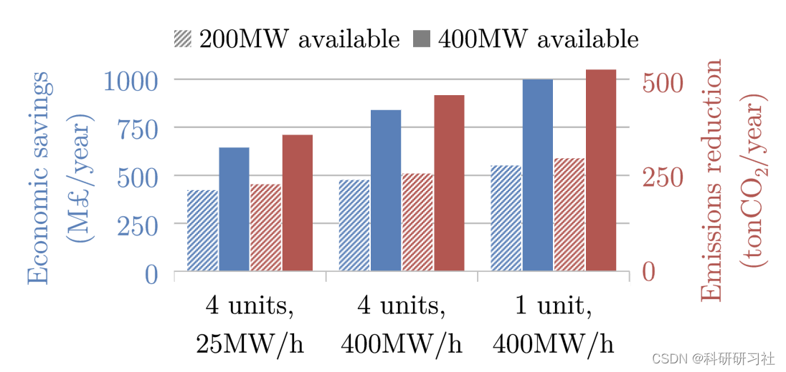
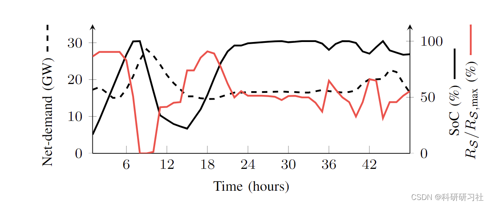
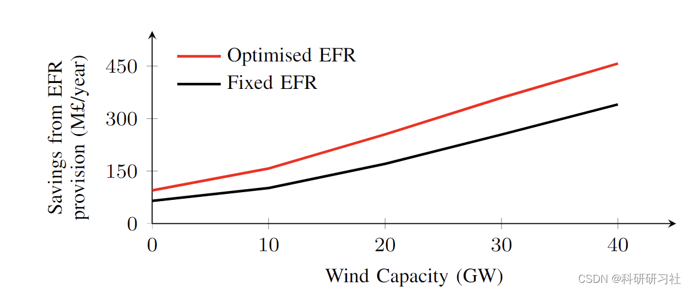
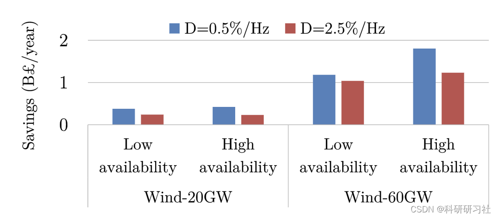

# [Unit Commitment] Two-stage, Multi-period Stochastic Unit Commitment (SUC) Problem (Matlab Code Implementation)

​  
1 Abstract. The reduction in system inertia level in a low-carbon power grid increases the demand for alternative frequency services. However, considering the challenges of linking steady-state optimization with frequency dynamics, simultaneously optimizing the provision of these services during the scheduling process is highly uncertain and presents a complex task. This paper proposes a novel Frequency Constraint Random Unit Commitment (SUC) model that optimizes energy production while simultaneously providing synchronization and synthetic inertia, enhancing frequency response (EFR), and primary frequency response (PFR). The contribution of load damping is modeled through linear internal approximation. Several case studies from the UK's 2030 electricity system demonstrate the effectiveness of the proposed model, highlighting the synergistic and conflicting effects between alternative frequency services, as well as the significant economic savings and carbon emission reduction achieved through simultaneous optimization of all these services.
The stochastic scheduling model minimizes the expected system operational costs while considering the uncertainty of RES. Uncertainty is explicitly modeled in the scenario tree depicted in Figure 1, which is constructed using the quantile-based scenario generation method described in [14]. Each scenario corresponds to a quantile of the user-defined distribution of net demand (demand minus wind power). The study in [14] demonstrates the effectiveness of this method by selecting a small number of scenarios. From these quantiles, the system conditions and the probabilities of reaching specific nodes can be derived from the tree. For simplicity, only branch construction at the current time point is used, as it has been proven that this method can provide similar results for more complex tree structures while significantly reducing computational time.
Editor
Figure 1. Scenario tree diagram for use in SUC
3. Matlab code and detailed article. This article only displays a part of the code, all code and detailed articles can be found in:
tic\n    \nObjective = sum(sum(prob_nodes.*Cost_node));\n\nConstraints = [Aux_constraints,...\n               Load_balance,...\n               Constraints_Gen_limits\n               Constraints_Ramp_limits];\n\noptions = sdpsettings('solver','gurobi','gurobi.MIPGap',0.1e-2);\n\nsolution = optimize(Constraints,Objective,options)\n\ntime.Optimisation = toc;\n  
4 Results Display
Editor
Editor
5 Conclusion This paper presents a SUC framework for collaborative optimization of energy production under uncertainty, as well as the scheduling of various frequency services, including synchronous and synthetic inertia, primary frequency response (PFR), EFR, and dynamically reduced maximum power injection. A set of linear constraints has been developed to ensure that post-fault frequency requirements are met. The accuracy and computational efficiency of these constraints have been studied in the context of highly computationally demanding SUC problems. Several case studies clearly demonstrate the benefits of introducing new frequency response services. The results also emphasize the importance of jointly optimizing alternative services to accurately capture their value. It is determined that three main areas can be enhanced for the proposed model. First, optimizing several frequency response products with different delivery times, rather than just EFR and PFR, will allow for the identification of different dynamics from suppliers, thereby forming an efficient market for auxiliary services. Second, this paper considers a unified frequency model while already recognizing the different frequency evolutions on the network's total lines. Further work is needed to investigate the impact of location frequencies on the value of these frequency services. Third, the influence of frequency safety constraints on pricing schemes is meaningful for designing effective auxiliary service markets for inertia and FR, thus strengthening [3] and [24] by incorporating the new frequency services discussed in this paper.
6 References [1] Gong Cheng, Song Liyun, Wang Wei, Wang Tengfei, Xia Shiwei, Zhang Dongying. Review on Robust Optimization in Power System Unit Scheduling Applications [J]. Science and Technology and Engineering, 2022, 22(12): 4687-4695.
[2] L. Badesa, F. Teng, and G. Strbac, "Simultaneous Scheduling of Multiple Frequency Services in Stochastic Unit Commitment," IEEE Transactions on Power Systems, vol. 34, no. 5, pp. 3858-3868, 2019.
[3] Tang Lun, Yao Li, Xiao Chang, Zhang Chi, Sun Yi, Guo Xia Ming, Liu Wei, Deng Fu Yao. Two-Stage Robust Unit Dispatch Considering Wind Power Uncertainty and Unit Outage Risk [J]. Smart Power, 2021, 49(02): 47-53.

## Images

<!-- PAYMENT_BLOCK -->

## Get this dataset

- Payment link (Stripe): [Buy now](https://buy.stripe.com/3cs8yP7sY87d0vu9AB)
- Payment QR code: 

<!-- /PAYMENT_BLOCK -->
